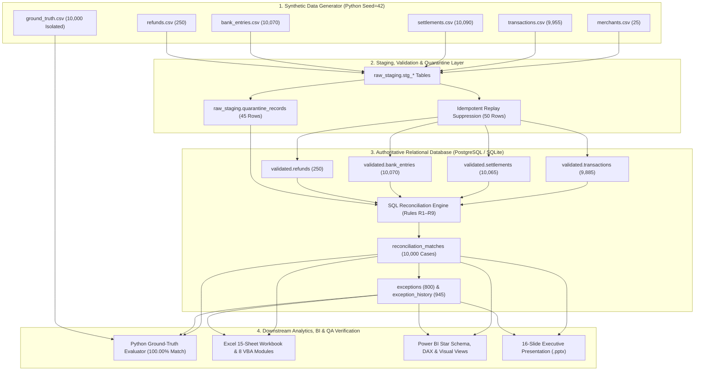

# SettlementIQ — System & Data Architecture

## 1. Component Architecture Diagram

## 2. Authoritative Data Ownership & Ground-Truth Isolation
- **PostgreSQL / Relational SQL** owns all reconciliation classifications, matching evidence, exception aging, and KPI source views.
- **Python** orchestrates ingestion, pre-load schema/monetary validation, database execution, and post-run evaluation against `ground_truth.csv`. Python never overrides SQL matching results.
- **Ground-Truth Isolation**: `data/ground_truth/ground_truth.csv` is never loaded into the reconciliation engine tables and is never referenced by `reconciliation_runner.py` or `05_reconciliation.sql`.
